# Franka Robotic Arm MCP

An MCP server that lets an AI agent work with a real Franka Research 3 (FR3) arm. It works with
Claude, Codex and any other MCP client.

The agent can read the robot's state and run tasks that you taught in Desk. Before anything moves,
the server checks the robot, the task and the arm's position. If a check fails, the task does not start.

<p align="center">
  
</p>

## What it checks

Every task start is checked first. The task is refused if any of these is not true.

1. It is the right robot. The robot's TLS certificate must match the pinned one.
2. You are logged in and own control of the arm. Control is never taken by force.
3. The task is exactly the version you approved. Its SHA-256 must match your local approval.
4. The arm is at Ready Home, joints `[0, -45, 0, -135, 0, 90, 45]` degrees, within 5 mm, 1 degree and 1 degree per joint.
5. The robot reports no singularity warning.
6. The robot has no errors, its self-tests pass and its brakes are open.

The server only starts tasks that were taught in Desk. It cannot send its own joint or Cartesian
targets, reset safety errors or activate FCI.

## Tools

There are 26 tools in four groups. Only `franka_real_execute_task` makes the arm move.

### Observe

These tools only read. They never change the robot.

| Tool | What it does |
|---|---|
| `franka_real_observe` | Reads system status, arm type, operating mode, FCI state and warnings |
| `franka_real_robot_state` | Reads joint angles, Cartesian pose, estimated forces, robot errors and the configured tool |
| `franka_real_joint_brakes` | Reads whether each of the seven joint brakes is locked or open |
| `franka_real_safety_status` | Reads recovery conditions and self-test results |
| `franka_real_diagnostic_events` | Saves the robot's event log and returns recent singularity, IK and motion planning lines |
| `franka_real_capabilities` | Reports the connection mode, login state and enabled tasks, using local files only |

### Tasks

These tools also only read.

| Tool | What it does |
|---|---|
| `franka_real_list_tasks` | Lists the tasks taught in Desk |
| `franka_real_preview_task` | Shows a task's full content, its SHA-256 and whether it is approved locally |
| `franka_real_task_status` | Reads whether Desk is running a task right now |

### Control

These tools change the robot's state. They need a Desk login.

| Tool | What it does |
|---|---|
| `franka_real_take_control` | Requests the control token, and fails if someone else holds it |
| `franka_real_release_control` | Gives the control token back |
| `franka_real_unlock_brakes` | Opens the joint brakes |
| `franka_real_lock_brakes` | Locks the joint brakes |
| `franka_real_execute_task` | Starts an approved task once every check passes, and the arm moves |
| `franka_real_stop` | Stops the running task and blocks new starts |
| `franka_real_resume` | Allows new starts again after a stop, without restarting anything |
| `franka_real_set_workflow_speed` | Changes the saved speed of the transfer workflow to between 1 and 40 percent, while it is stopped |

### Prepare

These tools upload task revisions that were checked in advance. They never approve or run them.

| Tool | What it does |
|---|---|
| `franka_real_prepare_home_tasks` | Saves the Ready Home task and the v06 workflow that starts and ends there |
| `franka_real_prepare_flange_inward_test` | Saves a 10 mm inward test move that returns to Ready Home |
| `franka_real_prepare_table_transfer` | Saves the v04 bare flange transfer routine |
| `franka_real_prepare_ground_relative_transfer` | Saves ground relative transfer revision v01 |
| `franka_real_prepare_ground_y_transfer` | Saves revision v02, which adds a 100 mm shift along Y |
| `franka_real_prepare_no_rotation_transfer` | Saves revision v03, with no rotations and 50 percent speed |
| `franka_real_prepare_no_rotation_speed30` | Saves revision v04, with no rotations and 30 percent speed |
| `franka_real_prepare_backwards_x_first` | Saves revision v05, which moves back along X first |
| `franka_real_prepare_tomato_source_fix` | Saves the corrected Tomato pick and place task, if its local helper file is present |

### Prompts and resources

| Name | Type | What it gives the agent |
|---|---|---|
| `franka_preflight` | Prompt | The checklist to follow before running a task |
| `franka_connection_help` | Prompt | Steps to find out why the robot cannot be reached |
| `franka://docs/connection` | Resource | The connection guide |
| `franka://docs/workflow-rules` | Resource | The Ready Home and workflow rules |

## Getting started

### Requirements

- Python 3.10 or newer
- A Franka Desk account
- Network access to the robot, either by Ethernet or over Wi-Fi through an SSH bridge such as a Raspberry Pi

### Install

```sh
git clone https://github.com/Hrishikesh332/Franka-Robotic-Arm-MCP.git
cd Franka-Robotic-Arm-MCP
bash setup.sh
```

The setup script creates a virtual environment, installs the pinned dependencies, creates
`config.json` and `task-policy.json` from the templates, and prints how to register the server.

### Configure

1. Save the robot's certificate as `robot-cert.pem`. [SETUP.md](SETUP.md#6-configuration-reference) shows how.
2. In `config.json`, set `robot_host` and set `connection` to `direct` or `tunnel`.
3. Fill in the certificate pin and check the file.

```sh
python3 -m franka_mcp.config init
python3 -m franka_mcp.config check
```

### Register with your client

For Claude Code, run the command below. The setup script also prints the settings for Codex and Claude Desktop.

```sh
claude mcp add franka-real -- "$PWD/.venv/bin/python" "$PWD/server.py"
```

### Connect each session

On macOS, double-click these files in order. SETUP.md has the matching commands for Linux.

1. `Connect Desk over WiFi.command` opens the SSH tunnel. You only need it in `tunnel` mode. Keep its window open.
2. `Connect Franka.command` logs in to Desk. You type the password locally and it is never saved. The login lasts one hour.
3. `Enable Franka Tasks.command` approves exact task versions. No task can run until you approve it.

To confirm the connection without moving the robot, run the probe.

```sh
.venv/bin/python server.py --probe
```

## Using it

Ask your agent in plain language. For example

- "Show me the FR3's status and joint angles."
- "List the taught tasks and preview the pick and place task."
- "Run the preflight for the pick and place task, then start it after I confirm."

A task run always follows the same order.

1. `franka_real_capabilities` checks the login and approved tasks.
2. `franka_real_robot_state` checks the pose and the singularity warning.
3. `franka_real_safety_status` and `franka_real_joint_brakes` check for faults and open brakes.
4. `franka_real_preview_task` shows the task and its hash.
5. You confirm.
6. `franka_real_take_control` gets the control token.
7. `franka_real_execute_task` starts the task.
8. `franka_real_task_status` follows it until it finishes.

`franka_real_stop` stops a running task at any time. The hardware emergency stop always works on its own.

## Configuration files

| File | In Git | What it holds |
|---|---|---|
| `config.json` | Only the template `config.example.json` | Robot address, certificate pin and connection mode |
| `task-policy.json` | Only the template `task-policy.example.json` | Approved task hashes and Ready Home tolerances |
| `robot-cert.pem` | No | The robot's certificate |
| `.session.json` | No | The Desk login token |
| `plans/` | No | Checked task data used before a task starts |

[CONNECTION.md](CONNECTION.md) explains the two connection modes and every connection error.
[SETUP.md](SETUP.md) covers setup, configuration and troubleshooting in full.

## Project layout

```text
server.py              Entry point that MCP clients start
franka_mcp/
  app.py               Builds the server with its tools, resources and prompts
  cli.py               Command line options such as --probe and --transport
  config.py            Loads and checks config.json
  login.py             Desk login and task approval
  desk/reader.py       Read-only connection with the pinned certificate
  desk/client.py       Desk client with all safety checks
  tools/               Observe, task, control and prepare tools
  resources/           Documents the agent can read
  prompts/             Prompt templates
setup.sh               Setup script
*.command              Session launchers for macOS
```

## Development

Browse the tools in the MCP Inspector.

```sh
npx @modelcontextprotocol/inspector .venv/bin/python server.py
```

To add a tool, write an `async def franka_real_...` function in the matching module in
`franka_mcp/tools/`. Its docstring becomes the tool description. Then add it to that module's
`READ_TOOLS` or `CONTROL_TOOLS`.

The code is formatted and linted with ruff. The settings are in `pyproject.toml`.

```sh
ruff format .
ruff check .
```

## Safety

- Keep the emergency stop within reach whenever a task may run.
- Delete `.session.json` when you finish, because it is a live login token.
- Do not move the robot just to test the setup. The read tools and the probe never move it.
- Control uses the endpoints of Desk's own web page, which Franka does not document. A firmware update can change them.
